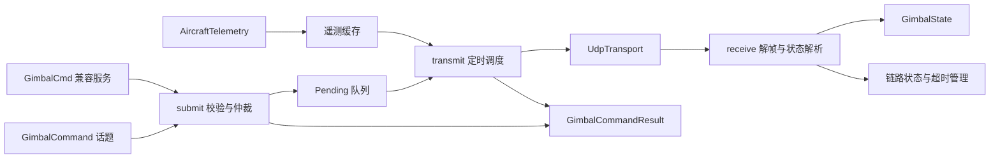
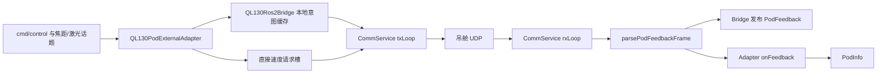

# Controller 节点对比与修改建议

对比日期：2026-10-23。以工作区当前源码为准，包括未提交的文件。

- 当前项目：`uav_system/master_ws/src/controller`，ROS 包名 `flight_controller_ros2`。
- 参考项目：`ros2_uavs_8.0.0/external/controller_node`。
- 本文只新增分析文档，没有修改实现；协议单元测试已独立编译运行通过，未做 ROS 全链路或实机验证。
- 下文 A 指当前项目，B 指参考项目。A 路径相对 `uav_system/`，B 路径相对 `ros2_uavs_8.0.0/`。

## 1. 总体判断

A 是带命令生命周期管理的 QLET 网关，重点是参数校验、TTL、控制源租约、停止优先和链路状态。
B 是 QL130 专用适配器，重点是外部控制模式翻译、启动配置、红外/可见光能力、伺服模式切换。

建议保留 A 的调度和失效处理基础，补上设备 profile、模式状态机和设备状态确认。
无需为了采用 B 的分层而改为多线程，也不宜整套替换为 B 的最新意图缓存。

两者的 controller 主要都控制吊舱。A 额外提供的飞机导航是模拟实现，不是实际飞控控制器。

## 2. 架构与数据流

### A：单线程执行器 + 非阻塞 UDP + 显式发送队列



- `ControllerNode` 同时负责 ROS 接口、命令队列、仲裁、看门狗、遥测编码和模拟导航。
- `qlet_protocol` 负责命令到协议数据的转换、帧编码和反馈解析。
- `UdpTransport` 负责 socket 生命周期、非阻塞读写、源 IP/端口过滤。
- RX 定时器 5ms，每次最多处理 64 个数据报；TX 默认 20ms；链路发布周期 100ms。
- `main.cpp` 使用 `rclcpp::spin(node)`，状态串行访问。换成多线程执行器前必须重新审查同步。

### B：外部适配层 + 意图缓存 + 收发线程



- ROS spin、UDP 接收和发送分别运行在线程中，主线程做统计和退出管理。
- `QL130PodExternalAdapter` 处理控制权、时间戳判重、模式翻译、前置动作和启动动作。
- `QL130Ros2Bridge` 创建 ROS 节点、发布反馈，使用 mutex 保护最新意图缓存。
- `QL130PodCommService` 管理 UDP、发送优先级、变化去抖和单次命令回显计数。
- 注意：普通外部控制/焦距回调大多直接覆盖意图槽；`action_queue_` 主要用于启动动作，
  不能把 B 描述成所有运行时命令都可靠入队。

## 3. 函数对应表

| A 的函数/位置 | 当前功能 | B 的对应函数 | 修改时的关注点 |
| --- | --- | --- | --- |
| `ControllerNode()`，`controller_node.cpp:11` | 加载参数、创建接口/socket/定时器 | `apps/controller.cpp:main`、Bridge 构造、Adapter `start()`、Service `init/start()` | A 的节点构造承担职责较多，可拆出配置与调度组件 |
| `submit()`，`:75` | 命令编码、范围/时间校验、在线检查、source 租约、合并与入队 | Adapter `onControlCmd/onIrFocalCmd/onVisFocalCmd/onLaserModeCmd` | B 增加型号业务语义；A 的 TTL 和队列上限应保留 |
| `transmit()`，`:127` | 停止优先、TTL 到期停转、队列过期处理、发送结果、遥测发送 | Service `txLoop()` + Adapter `onTimer()` | A 更关注生命周期；B 增加变化去抖、初始化和模式前置动作 |
| `receive()`，`:178` | 有界收包、解帧、筛选 0x0014、刷新链路、发布状态 | Service `rxLoop()` + `parsePodFeedbackFrame()` | 两者反馈封装和字段解释不同，需明确设备 profile |
| `online()`，`:68` | 按 steady clock 判定反馈是否新鲜 | B 无同等对外在线门控 | A 的反馈超时判定应保留 |
| `expire_queue()`，`:123` | 清空队列并逐条发布 expired | B 意图槽覆盖及启动动作出队 | 断链清队列时应区分普通运动与停止请求 |
| `result()`，`:71` | 发布关联 command_id/source 的命令生命周期事件 | Service `getOneShotStats()` 仅统计确认/未回显次数 | A 更便于任务追踪；需补设备状态确认，避免把 sent 当完成 |
| `publish_state()`，`:204` | 原始工程单位反馈 + 兼容 JSON | Bridge `toRosMsg/publishFeedback` + Adapter `onFeedback` | 框架角与姿态角保持分开；字段语义不能仅按相近名称映射 |
| `publish_link()`，`:198` | online、反馈年龄、收发与错误计数、队列长度 | 主循环打印统计 | A 的结构化诊断更便于上层使用 |
| `telemetry()`，`:220` | 校验新鲜飞行数据，编码 0x0402 | B controller 内无直接对应实现 | A 已有输入接口，但生产飞控数据源尚未接通 |
| `setup_navigation_stub()`，`:242` | 模拟 goto/orbit，到时间置 arrived | B controller 不承担；导航另在 navigator | 从生产 controller 中移出，单独提供 mock 节点 |
| 析构函数，`:55` | 正常退出时停止本节点启动的转动和变倍 | Service `stop()` 停线程、关 socket | B 不会因为停止发指令而自动发零速帧 |
| `make_command()`，`qlet_protocol.cpp:30` | 字符串命令到 Frame，含范围验证 | Adapter 模式翻译 + `QL130PodCommands.h` + `build*RequestFrame()` | 可拆分设备能力、命令校验与协议编码 |
| `encode()`，`:24` | FB 2C AA、长度、小端命令字、XOR | `buildRequestFrame()` | 两者发送封装基本一致；A 有 payload 长度上限检查 |
| `decode_datagram()`，`:70` | 单个 UDP 包内多帧、噪声重同步、不拼跨包残帧 | `parsePodFeedbackFrame()` 的帧校验分支 | B 仅接受整个数据报恰为 64/67 字节，A 接收封装更灵活 |
| `decode_state()`，`:83` | 解析至少 60B 状态数据段 | `parsePodFeedbackFrame()` 的字段解析部分 | 经纬度类型及目标像素字段语义需要核对 |
| `UdpTransport::receive()`，`udp_transport.cpp:32` | 严格检查源 IP 和端口 | Service `rxLoop()` 不过滤来源 | 不建议取消 A 的来源检查；有多端口设备时应明确配置策略 |

## 4. 功能覆盖与实际差异

| 维度 | A 当前实现 | B 当前实现 | 建议 |
| --- | --- | --- | --- |
| 速度 | 0x82，0.01°/s，±50°/s | 0x70，1°/s，±50°/s，变化才发 | 用设备 profile 选择编码和对应零速帧 |
| 角度指向 | `point` 0x72、`attitude_point` 0x7C | 外部 LOCK 按配置选 0x72/0x7C | 明确框架角/姿态角；不能按 lock 名称直接迁移 |
| 冻结/方位锁定 | `lock/freeze` 映射 0x7A | 外部 LOCK 是目标角度指引 | 名称相似但协议语义不同 |
| 归中、下视 | 支持，另有收藏、扫描、随动等 | 外部接口暴露归中、下视等常用模式 | A 的基础命令覆盖并不比 B 少 |
| 图像选点跟踪 | 0x3A，中心偏移 ±960/±540 | 相同范围，外部自动跟踪模式映射 0x3A | 使用图像分辨率和坐标约定，勿把反馈脱靶量当绝对选点 |
| 地理指引/跟踪 | 未暴露 | 0x1B/0x1C，12B 数据 | 按任务需要增加经纬度、高度及基准定义 |
| 可见光焦距 | 0x4C，协议范围 0.1~6500mm | 0x4C，QL130 范围 4.8~158mm | 在通用协议范围之上增加设备能力限制 |
| 红外焦距 | 发布反馈，没有独立控制入口 | 固定 35mm 镜头，映射 1~4 倍电子放大 0x54 | 不要将型号专用电子放大当通用光学变焦 |
| 测距 | 单次、连续 1Hz、停止 | 可配置 1~50Hz，支持强制关闭 | 按设备需求补参数；不必复制全部型号能力 |
| 拍照、录像、显示 | `make_command()` 已提供明确命令入口 | 有通用组包及部分常量；外部话题未逐项暴露 | 区分“定义了常量”和“存在完整调用通路” |
| 启动配置 | 未发送专门初始化序列 | 延迟 500ms，逐条发送配置、初始下视/归中、可选停测距 | 增加显式可配置初始化，串行执行并记录结果 |
| 模式迁移 | 无基于反馈 servo_mode 的前置状态机 | 跟踪态先取消跟踪；手动态先零速；延迟后发目标模式 | 借鉴迁移规则，进一步用新鲜状态确认 |
| 控制权 | source + TTL 租约，跨源 stop 可提交 | Manual/Programmatic，自动跟踪绕过过滤 | 人工接管应清除旧队列，并有明确优先级和释放规则 |
| 判重 | 同类型排队命令被新值覆盖，无 command_id 去重 | 每个入口比较上一条 timestamp_ms 是否相同 | 时间戳判重不等于过期拒绝；离散动作如拍照需考虑 ID 去重 |
| 完成确认 | accepted/sent 等，本地语义清楚 | 回显计数，超时释放，无可靠到位判定 | 建立 sent、echoed、state_confirmed 的区别 |
| 无真实反馈 | 不发布伪造 GimbalState，链路标离线 | 首次真实反馈前按周期发布配置默认值 | B 配置中 default_feedback.valid=1，不应照搬到生产真实状态通路 |
| 多机隔离 | 相对 topic + ROS namespace，通常 `/uav1/...` | 绝对 `/uav_<id>/...`，消息再检查 platform_id | 统一项目自身 namespace 即可，无需强制换命名体系 |

## 5. 应优先修改的问题

### P0：确认速度与停止指令是否适配实机

A 的 `make_command()`、`transmit()` 的 TTL 停止、析构停止均硬编码 0x82。
B 的 README:92 记载该项目实机使用 0x82 不响应，改用 0x70；这是参考项目的设备记录，
不是本次实机复验，也不表示所有 QLET 设备都不支持精调。

建议在一个设备 profile 内统一定义速度命令字、缩放、范围和停止编码，所有路径调用
同一个 `make_stop()`，避免只改 velocity 正常路径而遗漏看门狗和析构路径。
粗调会将低于半度/秒附近的请求量化为零，上层跟踪参数也需随之验证。

### P0：区分反馈封装与数据布局

A 接受 `FC 2C 55` 变长封装，仅处理 0x0014，并按表14将经纬度解释为 INT32×1e-7。
B 接受 64B `FC 2C ... F0` 和 67B `FC 2C 55 ...`，两种都把经纬度解释为 FLOAT32。

本次核查仓库 QLET PDF：表6写 FLOAT，表14写 INT32，差异确实存在。
因此“支持同一个 67B 帧头”不代表字段解析兼容；不要直接把 A 的 INT32 全部改成 FLOAT。
建议分别配置封装与字段布局，用来自实机且已知经纬度/姿态/焦距的抓包金样验收。
特别是 A 的 `target_x/target_y` 反馈实际位于跟踪脱靶量字段，建议改名或补注释说明。

### P0：修复离线停止请求被清队列

静态代码路径：A `submit()` 允许 `stop` 和 zoom 停止在离线时入队，但 `transmit()`
只要 `have_feedback_ && !online()` 就先调用 `expire_queue()` 清除全部待发命令。
因此“收到过反馈后离线”时，新提交的停止也会被清掉。首次尚未收到反馈时不走该分支。

内部 `velocity_active_/zoom_active_` 仍能触发自动停止，这不能替代所有显式停止请求，
例如未被本节点记录的运动，或上层要求再次停止的情况。
建议将停止放进独立的高优先通路，断链只清除普通动作；保留发送间隔限制与停止结果记录。
增加“先收到反馈→停发反馈→提交跨源 stop/zoom stop→检查实际 UDP 停止帧”的回环验收。

### P0：隔离模拟导航

`setup_navigation_stub()` 忽略 goto/orbit 的目标参数，只按定时器切换 NavState。
行为树 `master_ws/src/behavior/ros2/bt_nodes/src/nav_nodes.cpp:35` 仍调用该服务。
生产模式应改接真实导航执行器，模拟节点只在明确的仿真配置中启动。

### P1：增加伺服模式状态机和设备完成判据

保留 A 的队列，但让一个逻辑请求可以展开成多步事务，例如：

```text
跟踪态收到角度指向请求
  → 发 cancel_track
  → 观察新鲜反馈确认退出跟踪（或明确失败/超时）
  → 发 point / attitude_point
  → 用相应角度误差和稳定持续时间判断到位
```

B 的前置动作主要靠 2×发送周期等待，从请求时间开始计时，并非设备状态闭环；
可借鉴规则，不应把固定等待直接视为确认。普通运动的超时和显式停止也需分清：
point 的 TTL 当前只限制发送时效，不会自动中断已执行的位置动作。

### P1：修改行为树的成功语义

当前 `nav_nodes.cpp:GimbalCommand::tick()` 在服务返回 ok 后立即 SUCCESS。
而 controller 的 ok 仅表示成功入队，后续仍可能过期或发送失败。
建议用带 command_id 的请求/结果链路或 ROS Action，并为指向、跟踪、焦距分别定义完成条件。
接入 source 租约时，还需给行为树、人工和算法分配明确的 source，避免全部使用
`legacy_service` 而失去来源区分。

### P1：补设备能力、初始化和飞控遥测数据源

- 在配置中声明型号、固件/profile、机械范围、光学范围、模式支持与启动序列。
- 启动序列不应在任意时刻覆盖运行命令；需要明确初始化阶段、完成状态和失败行为。
- A 已实现 0x0402 编码，但 telemetry 默认关闭；搜索生产源码未发现 AircraftTelemetry
  发布器，当前存在的是测试发布器。应建立飞控状态转换层，补齐 UTC、卫星数、坐标系和高度基准。
- 地理指引、红外放大等按实际需要扩展；不必一次复制参考项目全部接口。

## 6. B 中不宜直接复制的实现细节

1. **没有运动意图看门狗**：速度变化发一次，停发不补零速；Service `stop()` 只关闭通信。
2. **无可靠逐请求确认**：`txLoop()` 超过 2×tx_period 后释放挂起槽，不重发；部分注释/文档的
   “重试”说法与实际代码不一致。旧的相同 cmd_echo 也不能证明刚提交的请求已经执行。
3. **运行时离散指令会覆盖**：多个回调在 txLoop 读取前调用 `applyOneShot()`，可能仅保留最后一条。
4. **时间戳只判等、不判新鲜**：旧指令只要不等于上一条时间戳仍可能执行。
5. **默认状态可被标为有效**：随附配置将默认反馈 valid 设置为 1；下游不能据此证明设备在线。
6. **去抖与发送成功耦合不足**：速度/地理快照在 sendto 前更新；若发送失败，相同值可能不会重新触发。
   直接速度请求在高优先级单次帧同时出现时也缺少可靠的待发送保留机制。
7. **自动跟踪绕过控制权过滤**：这未必符合你项目的人工接管要求。

## 7. 推荐的修改形态与顺序

维持单线程执行器，逐步把 `ControllerNode` 拆成以下职责；初期可先抽函数和结构体，
不必马上增加多个类或 ROS 节点：

```text
ControllerNode       ROS 参数/消息/服务转换
CommandScheduler     入队、TTL、source、抢占、停止优先、生命周期结果
GimbalStateMachine   模式前置动作、事务、反馈完成判定
QletDeviceProfile    型号命令、字段布局、能力边界
QletCodec            纯协议编解码
UdpTransport         网络读写与来源检查
MockNavigator        单独的模拟导航节点
```

推荐实施顺序：

1. 确认实机速度/停止 profile 与反馈金样；修复离线停止清队列；隔离模拟导航。
2. 加入模式迁移事务和设备确认；调整行为树成功语义与人工接管。
3. 加入设备能力/启动序列、飞控遥测桥接，以及实际需要的地理/红外能力。
4. 最后整理类与文件结构，保持已有 TTL、队列上限、来源过滤和不重放旧控制的行为。

验收重点：停止可实际发出、断链不回放旧动作、旧回显不冒充新确认、模式切换失败可观测、
人工接管后旧程序命令不继续执行、拍照等离散动作不被错误重试。

现有 `test_qlet_protocol.cpp` 本次通过；其速度测试和网关模拟器都按当前 0x82 假设构造，
不能用这些测试的通过证明实机支持 0x82。需要独立设备金样和受控实机联调。
