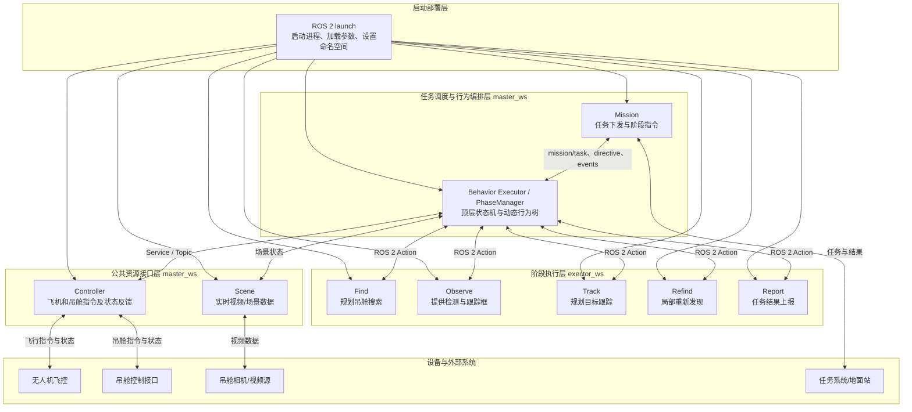
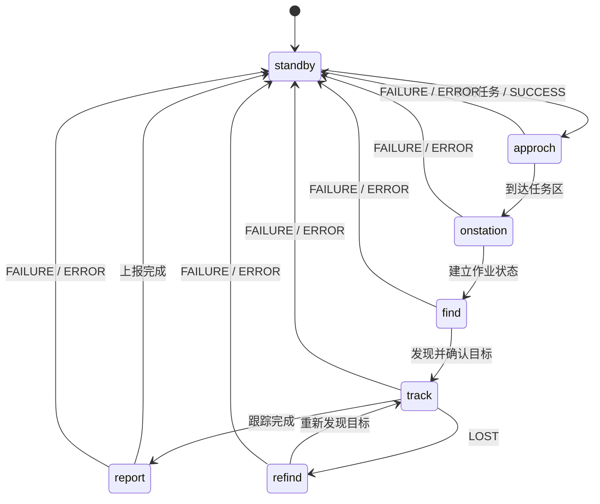

# UAV System 运行流程图

本文档替代原来的 `流程图.jpg`，内容与当前代码结构和阶段配置保持一致。

## 系统分层



## 顶层状态机



`approch` 的拼写按当前项目接口约定保留。只有目标丢失结果 `LOST` 进入
`refind`；插件加载、建树、通信、超时和执行异常均回到 `standby`。

## 阶段与动态插件

| 阶段 | 动态加载的能力库 |
| --- | --- |
| `standby` | mission、controller、scene |
| `approch` | navigation、controller、scene、mission |
| `onstation` | controller、scene、mission |
| `find` | find、observe、controller、scene |
| `track` | track、observe、controller、scene |
| `refind` | refind、observe、controller、scene |
| `report` | report、scene、mission |

每个阶段可以加载多个插件库；同一个公共能力库被多个阶段引用时，进程内只动态加载
一次。XML 负责描述行为控制流，`config/executors/phase_*.json` 负责描述插件组合。

## Controller 目录

Controller 当前只有 ROS 2 实现，因此直接作为 `master_ws/src` 下的 ROS 2 package：

```text
master_ws/src/controller/
├── CMakeLists.txt
├── package.xml
└── src/
    └── main.cpp
```

它提供：

- `controller/goto`：飞往指定位置；
- `controller/orbit`：建立盘旋；
- `controller/gimbal`：控制吊舱；
- `controller/nav_state`：反馈飞机导航状态；
- `controller/gimbal_state`：反馈吊舱状态。
